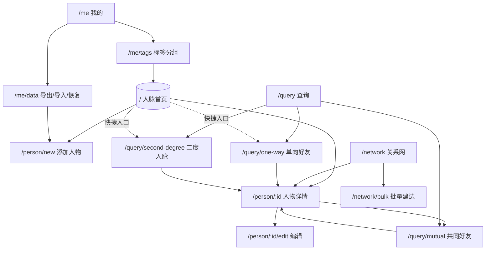
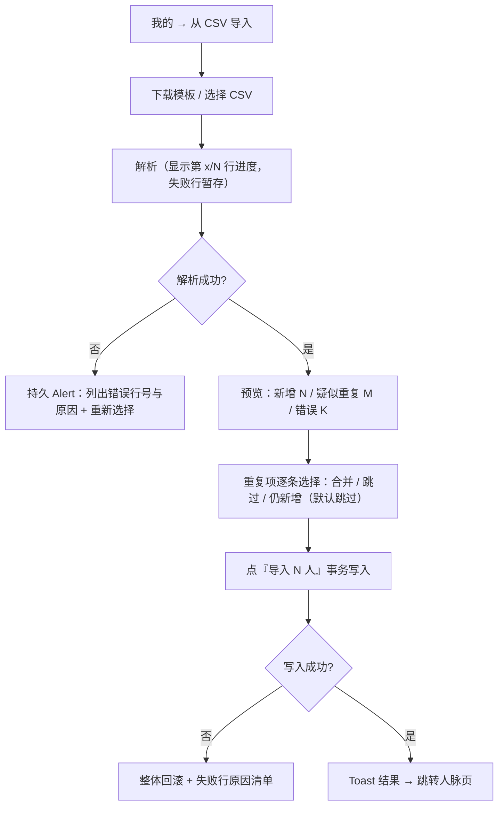
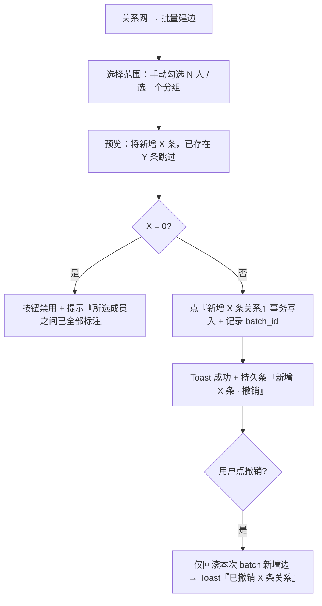
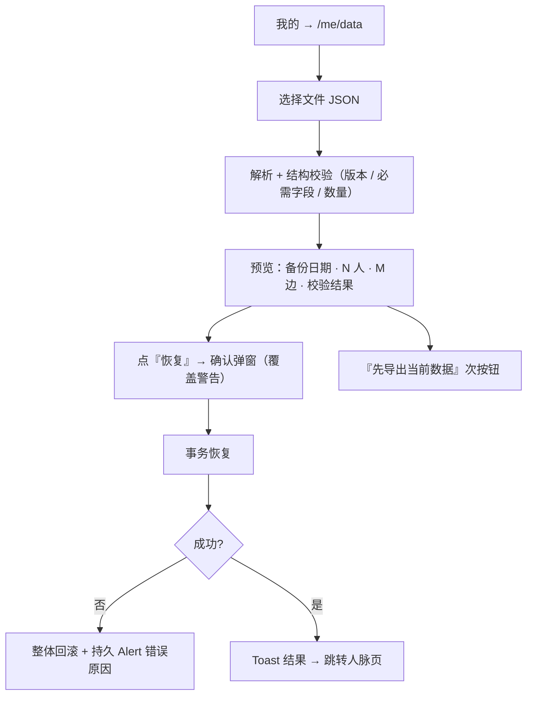
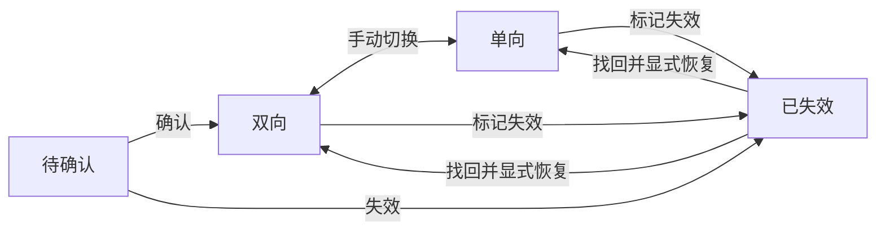

# LinkMap-人脉本 · 体验与信息架构规范 v1.0

> **历史文档**：本规范描述的是早期「好友状态 + 查询 + 二级关系」模型。当前实现已改名为 WhoYouKnow，导航为「人脉 / 关系网 / 我的信息 / 整理分类 / 系统设置」，联系人只通过分组 / 圈子 / 标签整理，不保存联系人彼此的关系。产品事实以 [`README.md`](../../README.md) 为准。

- 阶段：Phase 2 体验与信息架构规范
- 上游依据：`/docs/个人人脉管理应用PRD.md`、`/docs/design/01-视觉设计规范.md`（Phase 1，视觉结论为**给定约束，本规范不推翻、不重定义色板/字号/组件外观**）
- 技术基线：React + Vite + TypeScript，本地优先响应式网页应用，localStorage/IndexedDB，无后端、无账号
- 下游对接：Phase 3 前端工程落地实现
- 本规范只定义「信息怎么组织、任务怎么走、反馈怎么说、不同设备与不同能力的人怎么操作」，组件外观一律引用 Phase 1 的 Token 与组件规格

---

## 0. 本规范的边界与基本原则

### 0.1 三条铁律在交互层的翻译

| 铁律 | 交互层含义 | 禁止出现的交互 |
| --- | --- | --- |
| 手动维护优先 | 任何数据变更必须由用户显式发起并可见 | 自动抓取、自动合并、自动标状态、后台静默同步 |
| 不做复杂算法 | 所有查询是确定性集合运算，结果可解释、可复算 | 相似度打分、智能推荐、亲密度、社群发现、"猜你想认识" |
| 隐私本地优先 | 所有导出/恢复是本地文件动作，UI 明确说明数据不出设备 | 云同步提示、上传进度、账号登录引导 |

### 0.2 全局交互原则（Nielsen 视角）

1. **状态可见**：每次写操作都有可见结果（Toast / 列表即时更新 / 计数变化），不允许"点了没反应"。
2. **防错优先于报错**：破坏性操作前置确认，可逆操作提供撤销，批量操作先预览再执行。
3. **可逆性**：删除人物有确认；状态切换、转为好友、批量建边提供「撤销」；导入/恢复是事务，失败整体回滚。
4. **一致性**：同一动作在全站只有一种叫法（「保存」「确定」「删除」「复查」「转为好友」），同一状态只有一种徽章。
5. **识别而非回忆**：筛选条件、选人数量、当前中间人筛选、已选分组始终在界面上可见，不靠用户记忆。

---

## 1. 信息架构总览

### 1.1 总体结论

**4 个一级目的地（Tab）保持不变：人脉 / 查询 / 关系网 / 我的。**

- 一级导航只承载「目的地」，不承载「动作」；添加、导入、建边、复查等动作全部在对应目的地内部发起。
- 人物详情、添加人物、批量建边、标签分组管理、数据管理为**二级/叶子页面**，不占一级 Tab。
- 「单向好友」「二度人脉」是**查询目的地的两个子页**，同时从人脉首页提供快捷入口——**一个目的地，多个入口**，不做两套页面。

### 1.2 完整路由清单

| 路由 | 页面 | 层级 | 主要任务 | 入口 |
| --- | --- | --- | --- | --- |
| `/people` | 人脉（首页，默认 `/`） | 一级 | 浏览/搜索/筛选人物、查看快捷入口 | Tab 1 |
| `/person/new` | 添加人物 | 二级 | US-001 | 人脉页 FAB、查询结果为"不认识"时的补录 |
| `/person/:id` | 人物详情 | 二级（核心页） | 编辑、状态切换、认识边维护、查共同好友、删除 | 所有人物列表/卡片/查询结果 |
| `/person/:id/edit` | 编辑人物 | 三级 | US-004 全字段编辑 | 详情页「编辑」 |
| `/query` | 查询（默认重定向到 `/query/mutual`） | 一级 | 查询目的地容器 | Tab 2 |
| `/query/mutual` | 共同好友查询 | 二级 | US-007 | 查询子导航、人物详情「查共同好友」 |
| `/query/one-way` | 单向好友清单 | 二级 | US-008 | 查询子导航、人脉首页快捷入口 |
| `/query/second-degree` | 二度人脉清单 | 二级 | US-009 | 查询子导航、人脉首页快捷入口 |
| `/network` | 关系网 | 一级 | 按人浏览认识边、批量建边入口 | Tab 3 |
| `/network/bulk` | 批量建边 | 二级 | US-006 | 关系网主按钮、详情页「TA 认识的人」 |
| `/me` | 我的 | 一级 | 数据说明与分发中心 | Tab 4 |
| `/me/tags` | 标签与分组管理 | 二级 | US-003 | 我的页 |
| `/me/data` | 导出与备份恢复 | 二级 | US-011、US-002 CSV 导入 | 我的页 |
| `/me/settings` | 设置 | 二级 | 隐私锁、提醒开关（P1，本期不出现入口） | 我的页（本期隐藏） |

**层级约束**：从任一 Tab 到达最深功能（如 `/person/:id/edit`）不超过 3 次跳转；任何二级页面都能一次返回其父目的地。人物详情是"枢纽页"，可被所有页面深链进入，返回时回到来源页并保留其筛选/选人状态。

### 1.3 导航模型与桌面端最终结论

| 断点 | 布局 | 一级导航 | 决策 |
| --- | --- | --- | --- |
| `< 768px`（手机，主场景） | 单列，左右 16px 边距 | 底部 Tab Bar 固定，56px + 安全区 | 沿用视觉规范 4.4 / 5.8 |
| `768–1023px`（平板/横屏） | 单列，内容最大宽 640px 居中 | 底部 Tab Bar 固定 | 沿用视觉规范 4.4 |
| `≥ 1024px`（桌面宽屏） | 左侧导航 216px + 内容区最大宽 960px 居中 | 4 个 Tab 平移为**左侧竖向导航（图标 + 文字）**，底部 Tab 隐藏 | **确认 Phase 1 建议方案** |

**体验侧确认结论：采纳左侧竖向导航，不做替代方案。** 理由：

1. **心智模型零成本**：4 个目的地语义不变、顺序不变，用户只需换位置不需重新学习；改名/新增目的地时不会影响页面结构。
2. **符合工具型产品的宽屏习惯**：常用操作在屏幕左缘固定可达（屏幕边缘优势），指针移动距离短；若把 4 项底部 Tab 居中放在 1440px 屏幕上，会形成一座"孤岛"，每次切换都要跨越半个屏幕。
3. **标签常驻优于纯图标折叠**：4 项数量少，不存在空间压力；显示文字避免图标语义歧义（尤其「查询」与「关系网」），同时天然满足读屏与认知无障碍。
4. **与视觉规范零冲突**：图标、激活态颜色、圆角、阴影全部沿用 Phase 1；只是把同一组导航换到左侧。

**体验侧补充要求（不改动视觉规格，只约束行为）：**

- 断点切换时**保留浏览状态**：当前路由、搜索词、筛选条件、选人列表、列表滚动位置不得因窗口缩放而重置。
- 左侧导航使用 `<nav>` 语义地标并标注 `aria-label="主导航"`，当前项设置 `aria-current="page"`。
- 键盘用户可用 `Tab` 顺序到达 4 项；`Esc` 可从任意子页面返回父目的地。
- FAB 沿用视觉规范 4.5 的位置（右下），桌面端不额外增加第二个主按钮，保证"一屏一个 Primary"。

### 1.4 站点地图（Mermaid）



---

## 2. 四个 Tab 的页面结构与信息层级

> 以下线框只表达**结构、层级与信息优先级**，视觉样式（颜色、圆角、字号、阴影）全部以 Phase 1 为准。

### 2.1 人脉（首页 `/people`）

**信息层级（从上到下）**

1. H1 页面标题「人脉」+ 计数「共 N 位联系人」（计数用 `tabular-nums`）。
2. Sticky 搜索框（占位文案见视觉规范 5.4）。
3. 横向筛选条：`全部` `分组 ▾` `标签 ▾` `状态 ▾`，有筛选生效时尾部出现「清除筛选」。
4. **快捷入口区**（两张紧凑入口卡，不放大网格）：`单向好友 N`、`二度人脉 N` → 分别深链到 `/query/one-way`、`/query/second-degree`。角标用墨蓝小圆点，**禁止红点**。
5. 人物列表：人物卡片（视觉规范 5.1）。默认排序：**「重要」星标置顶 → 姓名升序**；副信息行显示 `标签 · 认识渠道 · 最近核实时间`。
6. FAB「+」添加人物。

```
┌──────────────────────────────┐
│ 人脉            共 128 位联系人 │
│ [🔍 搜索姓名 / 备注 / 标签]     │
│ [全部][分组▾][标签▾][状态▾] 清除 │
│ ┌────────────┬─────────────┐ │
│ │ 单向好友 6  │ 二度人脉 23  │ │ ← 快捷入口（链接，非独立页面）
│ └────────────┴─────────────┘ │
│ ┌──────────────────────────┐ │
│ │ (头像) 张三 ★   [双向]   > │ │
│ │        大学同学 · 聚会 · 3天前│ │
│ └──────────────────────────┘ │
│              ...              │
│                         ( ＋ )│ ← FAB
└──────────────────────────────┘
```

- **默认隐藏「已失效」**：见 §4.3；筛选面板内用说明文字告知找回方式。
- **空状态**：无好友 → 视觉规范 5.7 文案「还没有记录任何人」+ 添加按钮；无搜索/筛选结果 → 对应文案，**不额外造词**。
- 卡片内不放操作按钮；操作进详情页或左滑（见 §6.2）。

### 2.2 查询（`/query`）

```
┌──────────────────────────────┐
│ 查询                          │
│ [共同好友][单向好友][二度人脉]   │ ← 二级子导航，页面内切换
├──────────────────────────────┤
```

**A. 共同好友 `/query/mutual`**

1. 说明行：「选择 1 个人看 TA 的全部熟人；选多个人看共同熟人。关系由你手动标注。」
2. 选人区：搜索框 + 已选芯片（可 × 删除）+ 计数「已选 3/10」。
3. 主按钮「查询共同好友」——**不随选人自动查询**。
4. 结果区（查询后）：分组标题「已是我的好友（N）」「我还不认识（M）」，每条可点进详情，"不认识"组提供次按钮「加为好友」。
5. 条件变更后，结果区顶部显示提示「选择已变更，请重新查询」，旧结果置为低优先展示而非直接消失（防错）。

```
[🔍 搜索姓名]        已选 3/10
[张三 ×][李四 ×][王五 ×]
────────────────────
      [ 查询共同好友 ]
────────────────────
已是我的好友（4）
  · 赵六  [通过 张三、李四]  >
我还不认识（2）
  · 孙七  [通过 王五]  >  [加为好友]
```

- 空结果文案逐字沿用视觉规范 5.7：「暂无共同熟人（可能是关系边还没维护）」+「去补录关系」。

**B. 单向好友 `/query/one-way`**

1. 顶部**持久说明条**（信息型 Alert，非红色）：「状态由本人手动标记，非系统自动检测。」
2. 排序控件：「按标记时间（最近优先）」/「按姓名」，默认前者。
3. 列表项（视觉规范 5.6）：副标题 = 状态备注 + 标记日期；右滑「复查」。
4. 清单为空：文案「当前还没有标记为单向的人」+「去看看好友列表」。

**C. 二度人脉 `/query/second-degree`**

1. 顶部说明：「朋友的朋友里，你还没有加为好友的人。」
2. 筛选：「只看某位中间人 ▾」（选项来自有效好友），生效时显示「清除筛选」。
3. 列表项：中间人芯片（最多 2 个 +N）+「N 位中间人」，默认按中间人数量降序。
4. 右滑「转为好友」。
5. 空态：「暂无二度人选（可能是关系边还没维护）」+「去补录关系」。

### 2.3 关系网（`/network`）

**P0 定位：按人浏览关系的列表形态**，图可视化是 P1，本期不出现入口。

1. H1「关系网」+ 说明「认识关系由你手动标注，系统不会自动推断」。
2. 主按钮「批量建边」→ `/network/bulk`。
3. 列表：按好友展示，副信息「已标注 N 位认识的人 · 最近核实时间」。
4. 点击任一人 → `/person/:id`，在「TA 认识的人」区块维护认识边（**唯一维护入口**，避免两处编辑冲突）。
5. 响应式：`<1024` 单列列表；`≥1024` 内容区内两列卡片网格，利用宽屏但维持"一层深度"。
6. 空态：复用无好友文案「还没有记录任何人」+ 添加按钮。

```
┌──────────────────────────────┐
│ 关系网                        │
│ 认识关系由你手动标注，系统不会自动推断 │
│            [ 批量建边 ]        │
│ ┌──────────────────────────┐ │
│ │ 张三   已标注 5 位 · 3天前 > │ │
│ └──────────────────────────┘ │
│              ...              │
└──────────────────────────────┘
```

### 2.4 我的（`/me`）

**信息层级（按用户任务频率排序）**

1. H1「我的」+ **常驻隐私说明卡**：「所有数据只保存在这台设备上，不上传、不联网。」（信息型 Alert，常驻，非一次性 Toast）
2. 数据管理卡 → `/me/data`：
   - 「导出人物 CSV」「导出关系边 CSV」「导出 JSON 完整备份」
   - 「从 CSV 导入」（US-002）、「从 JSON 恢复」（US-011）
3. 整理卡 → `/me/tags`：标签与分组管理（增删改、删除时提示影响人数）。
4. 找回卡：「找回已失效人物」→ `/people?status=invalid`（预置筛选，进页面即可见结果）。
5. 说明卡：「关于状态」——四种状态的含义与"均为手动标记、非系统检测"。
6. 设置卡：本期仅保留入口占位说明；P1 的隐私锁、提醒开关**本期不渲染按钮**（不做死按钮）。

```
┌──────────────────────────────┐
│ 我的                          │
│ ⓘ 数据只保存在这台设备上，不上传   │
│ ┌ 数据 ─────────────────────┐ │
│ │ 导出 CSV / JSON 备份       │ │
│ │ 从 CSV 导入 / 从 JSON 恢复  │ │
│ └──────────────────────────┘ │
│ ┌ 整理 ─────────────────────┐ │
│ │ 标签与分组管理            > │ │
│ │ 找回已失效人物            > │ │
│ └──────────────────────────┘ │
│ ┌ 说明 ─────────────────────┐ │
│ │ 关于状态：均为手动标记      > │ │
│ └──────────────────────────┘ │
└──────────────────────────────┘
```

---

## 3. 关键用户流程

> 每个流程统一按 **入口 → 操作 → 系统反馈 → 出口** 描述；涉及不可逆/高风险处另标「高风险 & 降级」。

### 3.1 US-001 手动添加人物（目标 30 秒）

| 步骤 | 入口/操作 | 系统反馈 | 出口 |
| --- | --- | --- | --- |
| 1 | 人脉页 FAB「+」→ `/person/new` | 页面打开；**桌面端**自动聚焦姓名输入框，**移动端不自动聚焦**（避免键盘突然遮挡） | 停留表单 |
| 2 | 输入「姓名/备注名」（唯一必填） | 其余字段收在「更多信息（可选）」折叠区，默认不展开 | 停留表单 |
| 3 | 输入过程中/失焦时检测同名 | 若存在同名：姓名框下方**字段级提示**「已有 2 位同名的人」+「查看」链接；**不阻止保存**（PRD 允许同名不同人） | 停留表单 |
| 4 | 点「保存」 | 姓名为空 → 字段下错误「请填写姓名」，焦点回到该字段；通过 → 写入本地 | 见下 |
| 5 | — | Toast「已添加 张三」 | 跳转到**新人物详情页**，便于立即补录认识边 |
| 6 | 详情页次按钮「继续添加」 | 回到空表单 | 连续录入 |

- **高风险 & 降级**：误建重复人 —— 重名提示不拦截是产品决定，降级为在保存前展示同名人物卡片供对比；本地存储配额不足导致写入失败 —— 保留表单内容不清空，Toast「保存失败，数据未写入，请重试」。
- **30 秒保障**：必填仅 1 项、可选字段默认折叠、保存后直接进详情页而非回列表。

### 3.2 US-002 CSV 批量导入



| 步骤 | 入口/操作 | 系统反馈 | 出口 |
| --- | --- | --- | --- |
| 1 | `/me/data` →「从 CSV 导入」 | 顶部说明：「仅『姓名』必填；Excel 请另存为 CSV（UTF-8）」+「下载 CSV 模板」 | 导入页 |
| 2 | 选择文件 | 解析态：显示「正在解析第 x / N 行」；单行失败记录行号+原因后继续，不中断 | 导入页 |
| 3 | 解析完成，进入预览 | 汇总条「将新增 N 人 · 疑似重复 M 人 · 格式错误 K 行」 | 预览区 |
| 4 | 逐行处理重复项 | 三选一：`合并` / `跳过`（**默认**）/ `仍新增`；重复判定规则见 §8.2 | 预览区 |
| 5 | 点「导入 N 人」 | 按钮进入禁用+进度态防重复提交；事务写入 | 见下 |
| 6 | 成功 | Toast「成功导入 N 人，跳过 M 人」→ 跳人脉页 | `/people` |
| 7 | 部分行失败 | 整体回滚；持久 Alert 显示失败行原因清单 | 停留导入页，可修正后重试 |

- **高风险 & 降级**：① 覆盖已有数据 —— 导入**只新增/合并字段，绝不删除**已有记录；② 编码乱码 —— 强制 UTF-8（兼容 BOM），检测失败提示转码；③ 1000+ 行卡死 —— 分片解析 + 进度 + 可取消按钮；④ 误点"仍新增"造成重复 —— 默认选中"跳过"。

### 3.3 US-005 手动标注认识边

| 步骤 | 入口/操作 | 系统反馈 | 出口 |
| --- | --- | --- | --- |
| 1 | 人物详情页 →「TA 认识的人」→「+ 添加认识的人」 | 移动端底部抽屉 / 桌面 Popover，含搜索框 | 选择层 |
| 2 | 搜索已有好友并点选 | 已存在边的候选显示「已标注」且不可再选；点选时 Toast「你们已标注为认识」 | 选择层 |
| 3 | （选填）填写备注「依据」，如"同群" | 备注可留空 | 选择层 |
| 4 | 点「保存」 | Toast「已标注 张三 认识 李四」；抽屉关闭；列表即时插入（按姓名排序） | 返回详情页，可连续添加 |
| 5 | 备选：选「新建我还不认识的人」 | 快速新建只需姓名；明确文案「此人还不是我的好友」；建完自动连边 | 返回详情页 |
| 6 | 删除某条边 | 确认弹窗：「删除这条认识关系？删除后『张三』和『李四』将不再显示互相认识。」按钮「删除」 | 删除后 Toast「已删除 1 条关系」 |

- **高风险 & 降级**：① 把二度节点误当好友 —— 非好友节点**不显示四状态徽章**，只显示中性文字「未收录为好友」（避免被读成第五种状态）；② 重复建边 —— 无向边 `a-b` 与 `b-a` 视为同一条，前端按 id 排序后去重；③ 误删边 —— 确认弹窗 + 删除后 Toast 提供 5s「撤销」。

### 3.4 US-006 批量建边



| 步骤 | 入口/操作 | 系统反馈 | 出口 |
| --- | --- | --- | --- |
| 1 | `/network/bulk`（或详情页「批量添加」带入当前人） | 单选切换：`手动勾选` / `选择一个分组`，默认前者 | 建边页 |
| 2 | 勾选成员（支持搜索与分组筛选） | 顶部常显「已选 N 人」 | 建边页 |
| 3 | 点「下一步」 | 预览页：「将新增 X 条关系，已存在 Y 条将跳过」+ 边清单；公式 `X = N×(N−1)/2−Y` | 预览页 |
| 4 | 点「新增 X 条关系」 | 事务写入，记录 `batch_id` | 见下 |
| 5 | 成功 | Toast「已新增 X 条关系」+ **持久条**「本次批量操作：新增 X 条 · 撤销」 | `/network` |
| 6 | 点「撤销」 | 无需二次确认（可逆）；Toast「已撤销 X 条关系」 | `/network` |

- **高风险 & 降级**：① 选 50 人 → 1225 条边，性能与误操作风险高 —— 预览明确显示 X，超过 200 条时展示警示 Alert「将生成大量关系，建议按小组分批」；建议软上限 50 人（见 §9）；② 撤销误伤 —— 只删除本次 `batch_id` 新增的边，**不触碰操作前已存在的 Y 条**；③ 刷新后无法撤销 —— 最近一次 `batch_id` 持久化，刷新后仍可撤销一次，下一次批量操作或撤销后清除。

### 3.5 US-007 共同好友查询

| 步骤 | 入口/操作 | 系统反馈 | 出口 |
| --- | --- | --- | --- |
| 1 | 查询 Tab 默认页，或详情页「查共同好友」（带入当前人） | 说明「选 1 人看 TA 全部熟人，选多人看交集；关系由你手动标注」 | 查询页 |
| 2 | 搜索并添加 1~10 人 | 芯片 + 计数「已选 3/10」；满 10 人时继续添加禁用并提示「最多选 10 人」 | 查询页 |
| 3 | 点「查询共同好友」（不自动查询） | 计算确定性规则见 §8.2；结果分区显示 | 结果区 |
| 4 | 浏览结果 | 「已是我的好友（N）」「我还不认识（M）」两组；每条可进详情，"不认识"组有「加为好友」 | 详情页 / 原地 |
| 5 | 结果为空 | 逐字文案「暂无共同熟人（可能是关系边还没维护）」+「去补录关系」 | 跳 `/network` |
| 6 | 改动选人后 | 结果区提示「选择已变更，请重新查询」 | 重新点查询 |

- **高风险 & 降级**：① 关系边没维护导致"假空" —— 空态文案明确指向补录，不让用户以为"真的没有共同好友"；② 展示过期结果 —— 条件变更提示；③ 交集包含了选中人自己 —— 结果集统一剔除选中成员（见 §8.2）。

### 3.6 US-008 单向好友清单

| 步骤 | 入口/操作 | 系统反馈 | 出口 |
| --- | --- | --- | --- |
| 1 | 人脉首页快捷入口 / 查询子页 → 单向好友 | 顶部持久说明「状态由本人手动标记，非系统自动检测」；列表按标记时间降序 | 清单页 |
| 2 | 右滑某人点「复查」（或点进详情） | 复查面板：显示上次标记时间与备注；选项 `仍是单向（更新复查时间）` / `改为双向` / `标为已失效`，备注选填 | 面板 |
| 3 | 保存复查 | 仅复查 → Toast「已更新复查时间」，清单顺序不变；状态变更 → Toast + 该项移出清单 + 5s「撤销」 | 清单页 |
| 4 | 详情页直接切换状态 | 可填备注与日期（默认今天）；Toast「已改为双向」 | 来源页 |

- **高风险 & 降级**：① 误以为系统检测 —— 持久说明条常驻；② 误改状态 —— 5s 撤销；③ 复查打乱排序 —— `reviewed_at` 与 `status_updated_at` 分离，复查不更新后者（见 §8.2）。

### 3.7 US-009 二度人脉清单

| 步骤 | 入口/操作 | 系统反馈 | 出口 |
| --- | --- | --- | --- |
| 1 | 人脉首页快捷入口 / 查询子页 → 二度人脉 | 说明「朋友的朋友里，你还没有加为好友的人」 | 清单页 |
| 2 | 浏览列表 | 每项显示中间人芯片（最多 2 个 +N）与「N 位中间人」；默认按中间人数量降序 | 清单页 |
| 3 | 筛选「只看某位中间人」 | 结果即时收敛，显示「只看张三带来的人脉」+「清除筛选」 | 清单页 |
| 4 | 右滑「转为好友」 | 轻量表单：状态默认「双向」可改，备注选填；说明「中间人的认识关系会保留」 | 表单层 |
| 5 | 保存 | 创建 MyFriendship 记录；该项从清单消失；Toast「已将 孙七 加为好友」+ 5s「撤销」 | 清单页 |

- **高风险 & 降级**：① 已失效/待确认的人被误当"不认识" —— 排除规则见 §8.2；② 转为好友时错误地"修改"不存在的记录 —— 明确是**新建** MyFriendship；③ 中间人过多导致信息过载 —— 最多显示 2 个 +N，点 +N 展开。

### 3.8 US-010 搜索与筛选

| 步骤 | 入口/操作 | 系统反馈 | 出口 |
| --- | --- | --- | --- |
| 1 | 人脉页顶部搜索框输入 | **输入即生效**；姓名/备注名/标签模糊匹配， trim 首尾空格，不区分大小写 | 结果列表 |
| 2 | 点「分组 ▾ / 标签 ▾ / 状态 ▾」 | 移动端底部抽屉 / 桌面 Popover（视觉规范 5.5） | 筛选面板 |
| 3 | 勾选条件 | 面板内即时显示已选项，但**不应用到列表** | 面板 |
| 4 | 点「确定」 | 面板关闭；筛选条芯片变为激活态并显示已选数量；尾部出现「清除筛选」 | 结果列表 |
| 5 | 点「重置」或面板外关闭 | `重置` = 清空该维度并应用；点遮罩/返回 = **放弃本次未确定改动**，保留上次生效条件 | 结果列表 |
| 6 | 有筛选生效时输入搜索词 | 两者叠加（AND） | 结果列表 |

- **高风险 & 降级**：① 关闭面板误以为已应用 —— "确定"是唯一应用入口，面板外关闭明确不应用；② 已失效默认隐藏让用户以为人丢了 —— 状态面板内说明「已失效默认隐藏，选择『已失效』可找回」，我的页另有找回入口；③ 组合逻辑歧义 —— 维度内 OR、维度间 AND（见 §8.2）。

### 3.9 US-011 导出备份与 JSON 恢复



| 步骤 | 入口/操作 | 系统反馈 | 出口 |
| --- | --- | --- | --- |
| 1 | `/me/data` →「导出人物 CSV / 导出关系边 CSV / 导出 JSON 完整备份」 | Toast「正在生成文件…」→ 浏览器下载到本地指定位置；CSV 用 UTF-8 BOM 兼容 Excel | 本地文件，不经过服务器 |
| 2 | 「从 JSON 恢复」→ 选择文件 | 解析并校验：应用版本、必需字段、人物/边数量 | 校验结果 |
| 3 | 预览页 | 「备份日期 · N 位人物 · M 条关系边 · 版本」+ 校验结论；提供次按钮「先导出当前数据」 | 预览页 |
| 4 | 点「恢复」，弹出确认弹窗 | 文案逐字沿用视觉规范 5.10：「恢复将覆盖当前全部数据，建议先导出备份。」危险按钮「恢复并覆盖」 | 确认弹窗 |
| 5 | 事务恢复 | 成功：Toast「已恢复 N 位人物、M 条关系」→ `/people`；失败：整体回滚原数据不变 + 持久 Alert 原因 | 人脉页 / 停留预览页 |

- **高风险 & 降级**：① 覆盖不可逆 —— 强制确认弹窗 + 预览 + "先导出"次按钮三重防护；② 版本不兼容 —— 阻止恢复并说明原因，**不允许部分恢复**；③ 文件非本应用备份 —— 结构校验失败，持久 Alert「这不是 LinkMap 的备份文件」。

---

## 4. 状态管理规则

### 4.1 四状态的权威定义与入口默认值

| 状态 | 含义 | 新记录默认值 | 徽章（沿用视觉规范 5.2） |
| --- | --- | --- | --- |
| 双向 | 我与对方互相认识 | **手动添加 / CSV 导入**默认此状态（用户主动录入视为已确认） | 绿 · 圆点 ·「双向」 |
| 单向 | 我加了对方、对方未加我或已删除我，**本人手动标记** | 不默认 | 琥珀 · 圆点 ·「单向」 |
| 待确认 | 来源未经本人确认（如通讯录导入） | **通讯录导入**默认此状态，用户确认后转「双向」 | 亮蓝 · 时钟 ·「待确认」 |
| 已失效 | 被删/拉黑/不再来往的历史关系 | 不默认 | 砖红 · 圆点 ·「已失效」 |

### 4.2 状态切换规则



- **入口**：人物详情页状态控件；单向清单的「复查」动作。切换时可选填 `status_note` 与日期（默认今天）。
- **确认时机**：状态切换**不需要确认弹窗**（可逆、轻量），保存后 Toast + 5s「撤销」。确认弹窗只用于 §5.3 列出的不可逆/批量场景。
- **禁止**：任何状态自动变化、自动过期、自动淡出动画（视觉规范 1.2 / 1.3）；所有变化由用户显式确认。

### 4.3 「已失效」默认隐藏与找回

- 人脉列表的状态筛选「全部」= 双向 + 单向 + 待确认，**不含已失效**。
- 找回路径两条：① 筛选条 → 状态 → 选「已失效」（面板内给出说明）；② 我的页 →「找回已失效人物」→ `/people?status=invalid`。
- 找回后详情页提供「恢复为双向/单向」；恢复**不改变**已有认识边。
- 「已失效」人物不参与共同好友、二度人脉的有效好友集合（见 §8.2）。

### 4.4 确认弹窗触发时机与文案

| 触发场景 | 是否确认 | 文案 | 危险按钮 |
| --- | --- | --- | --- |
| 删除人物 | 必须 | **逐字沿用视觉规范 5.10**：「删除「张三」将同时删除 TA 的 N 条认识关系，此操作不可撤销。」 | 「删除」 |
| JSON 恢复覆盖 | 必须 | **逐字沿用视觉规范 5.10**：「恢复将覆盖当前全部数据，建议先导出备份。」 | 「恢复并覆盖」 |
| 批量建边 | 必须（预览页即确认） | 「将新增 X 条关系，已存在 Y 条将跳过。」 | 「新增 X 条关系」 |
| 删除认识边 | 必须 | 「删除这条认识关系？删除后『张三』和『李四』将不再显示互相认识。」（沿用同一句式） | 「删除」 |
| 状态切换 / 复查 / 转为好友 / 导入 | 不确认 | Toast + 5s 撤销即可 | — |

> 弹窗外观（底部抽屉 / 居中 400px、遮罩、按钮排布、警示块）全部按视觉规范 5.10，本规范不改动。

---

## 5. 交互反馈规范

### 5.1 反馈组件选择原则（与用户既有 UI 反馈习惯一致）

| 反馈类型 | 使用场景 | 呈现 | 持续时间 |
| --- | --- | --- | --- |
| **Toast（轻量结果）** | 添加成功、标注成功、状态切换、复查、转为好友、导出完成、撤销完成 | 顶部/底部轻量条，不遮挡操作；可带「撤销」 | 普通 3s；带撤销 5s |
| **字段级错误** | 表单校验失败（如姓名为空、CSV 行格式错） | **定位到具体字段**：字段下方 12px 提示 + 焦点回到该字段；不做整页弹窗 | 直到修正 |
| **Alert（持续风险/说明）** | 数据仅本地、状态为手动标记、批量生成大量边、导入失败行清单、版本不兼容 | 页面内常驻信息条，用户可阅读后继续；**非模态** | 常驻直到条件解除 |
| **确认弹窗** | 删除人物、覆盖备份、批量建边、删除边 | 模态，按视觉规范 5.10 | 等待用户决策 |
| **加载态** | 解析/写入/计算 | 见下 | 见下 |

> 危险红（`#DC3428`）的**实心按钮与警示块**只用于删除/覆盖等破坏性确认；状态「已失效」用砖红弱化。表单错误文案使用危险 ink 作为文字级语义，不使用红底按钮/警示块（见 §9 待裁决项）。

### 5.2 加载与进度

- `< 300ms` 的操作**不显示**加载态，避免闪烁。
- `≥ 300ms`：按钮进入禁用态并显示进度文案（如「导入中…」），防重复提交。
- `≥ 1000ms`（CSV 解析 ≥100 行）：显示文字进度「正在解析第 x / N 行」+ 可取消按钮。
- 查询/筛选在本地计算（<500ms 目标），不显示全局遮罩，避免打断浏览。

### 5.3 按钮文案统一表（前端直接取用）

| 场景 | 文案 | 层级 |
| --- | --- | --- |
| 添加人物 | 「保存」（表单内）、FAB 仅「+」 | Primary |
| 导入 | 「导入 N 人」 | Primary |
| 查询 | 「查询共同好友」 | Primary |
| 筛选面板 | 「重置」（Ghost 左）+「确定」（Primary 右） | 按视觉规范 5.5 |
| 批量建边 | 「下一步」→「新增 X 条关系」 | Primary |
| 危险确认 | 「删除」「恢复并覆盖」 | Destructive |
| 复查 | 「保存复查」 | Primary |
| 转为好友 | 「加为好友」「转为好友」 | Primary |
| 空状态行动 | 「去补录关系」「清除筛选」 | Primary / 文字按钮 |
| 撤销 | 「撤销」 | Toast 内文字按钮 |

---

## 6. 响应式与无障碍

### 6.1 响应式策略

| 断点 | 导航 | 内容布局 | 交互差异 |
| --- | --- | --- | --- |
| `< 768px` | 底部 Tab Bar | 单列，左右 16px；内容底部留白 `calc(72px + env(safe-area-inset-bottom))` | 主操作左滑唤出；筛选/确认/选人用**底部抽屉**；FAB 右下 |
| `768–1023px` | 底部 Tab Bar | 单列，最大宽 640px 居中 | 同上 |
| `≥ 1024px` | **左侧竖向导航 216px** | 内容最大宽 960px 居中；正文升一档 16px | 主操作改为 hover 显示按钮组或「更多」菜单；筛选/确认/选人用**居中弹窗/Popover**；FAB 仍在右下 |

**切换规则**

- 断点变化只改变布局与控件形态，**不改变数据、路由与浏览状态**。
- 左滑操作在桌面端必须有等价入口（hover 按钮组 + 键盘可达的「更多」按钮）。
- 安全区 `env(safe-area-inset-*)`、`tabular-nums`、44×44 命中区按视觉规范 4.5 统一处理。

### 6.2 移动端手势

| 手势 | 行为 | 规则 |
| --- | --- | --- |
| 从右向左滑列表项 | 露出主操作（复查 / 转为好友）与破坏性操作（删除） | 位移 > 80px 触发；水平位移显著大于垂直才判定为滑动，避免干扰纵向滚动 |
| 从左向右滑 / 点空白处 | 关闭已展开的操作 | — |
| 点列表项主体 | 进入详情页 | 与左滑互斥， gesture 不误触发点击 |

- **任何手势操作都必须有非手势等价路径**（「更多」按钮），键盘与读屏用户不得被排除。

### 6.3 无障碍清单（验收项）

- [ ] 一级导航为 `<nav aria-label="主导航">`，当前项 `aria-current="page"`；查询子导航同理。
- [ ] 页面提供「跳到主要内容」skip link，`Tab` 首站可达。
- [ ] 焦点顺序 = 视觉阅读顺序：标题 → 搜索 → 筛选 → 快捷入口 → 列表 → FAB。
- [ ] 弹窗/抽屉打开时焦点移入标题或首个输入框，Tab 被限制在弹层内（focus trap），`Esc` 关闭并把焦点还给触发元素。
- [ ] 确认弹窗 `role="alertdialog" aria-modal="true"`；普通弹窗 `role="dialog"`。
- [ ] Toast 用 `role="status" aria-live="polite"`；字段错误用 `role="alert"` 并与输入框 `aria-describedby` 关联。
- [ ] 所有图标按钮有 `aria-label`（如「添加人物」「删除张三」）；筛选维度按钮有 `aria-expanded` / `aria-controls`。
- [ ] 四状态徽章**文字必读**，颜色与圆点只是冗余；非好友节点用文字「未收录为好友」，不新造徽章。
- [ ] 中间人信息可被读屏理解为「通过 张三、李四」；计数用 `tabular-nums` 不跳动。
- [ ] 所有可点区域 ≥ 44×44px，列表行 ≥ 64px（视觉规范 4.5）。
- [ ] 200% 文字缩放与 320px 窄屏下无横向滚动、无遮挡；FAB 不遮住最后一行（底部留白）。
- [ ] `prefers-reduced-motion: reduce` 时关闭 120/180ms 过渡与按压缩放。
- [ ] 不用红点、闪烁、颜色单独表意；禁用态不靠灰度单独传达原因（附文字说明）。

---

## 7. 高风险交互与降级方案汇总

| # | 高风险点 | 后果 | 降级/防护 |
| --- | --- | --- | --- |
| H1 | 删除人物 | 连带删除认识边，不可恢复 | 确认弹窗（5.10 文案）+ 明确 N 条边 + Destructive 按钮 |
| H2 | JSON 恢复覆盖 | 全量数据被替换 | 预览 → 确认弹窗 → 「先导出」次按钮 → 事务回滚 |
| H3 | 批量建边规模失控 | 50 人 → 1225 条边，卡顿+误操作 | 预览条数、>200 警示、软上限 50、batch 撤销 |
| H4 | 导入覆盖/乱序 | 改坏已有档案 | 只新增/合并不删除；默认「跳过」重复；事务回滚；错误行清单 |
| H5 | 空结果被误读为"真的没关系" | 用户放弃补录 | 空态文案明确指向"关系边还没维护"+ 补录入口 |
| H6 | 已失效被误删/误现 |  Historical 数据丢失或在二度里重现 | 默认隐藏 + 两条找回路径 + 状态集合统一排除 |
| H7 | 误把二度节点当好友 | 关系网失真 | 中性文字「未收录为好友」，不占用四状态徽章 |
| H8 | 手势误触/键盘不可用 | 移动与桌面体验割裂 | 阈值 80px + 水平优先 + 非手势等价入口 |
| H9 | 本地存储配额不足 | 数据写入失败 | 写失败保留表单、Toast 明确"未写入"，不静默成功 |
| H10 | 状态/复查时间混用导致排序跳动 | 清单顺序不稳定 | `reviewed_at` 与 `status_updated_at` 分离 |

---

## 8. 给 Phase 3 前端成员的交接要点

### 8.1 路由与状态

1. 按 §1.2 路由表建路由；`/query` 重定向到 `/query/mutual`；详情/编辑页可被任意列表深链进入。
2. 断点切换、页面返回时**保留**搜索词、筛选条件、选人列表、滚动位置（提到路由 query 或全局 store，不要留在组件局部 state）。
3. 最近一次批量 `batch_id` 需持久化，支持刷新后一次撤销。

### 8.2 【核心】查询集合运算的确定性规则

设：

- `N(p)` = 与人物 `p` 有认识边的**邻居 id 集合**（认识边无向，`a-b` 与 `b-a` 视为同一条，取邻居时两端都要能查到）。
- **有效好友集合 `F`** = `{ p | MyFriendship.status ∈ {双向, 单向, 待确认} }`，**不含「已失效」**。此定义被共同好友与二度人脉共用，不得各写一套。

| 查询 | 确定性公式 | 附加规则 |
| --- | --- | --- |
| 共同好友（选 1 人） | `R = N(p₁)` | — |
| 共同好友（选 k≥2 人） | `R = ∩ N(pᵢ)` | — |
| 共同好友结果清洗 | `R = R − {选中的人}` | 避免自指；按 id 去重 |
| 结果分组 | `已是我的好友 = R ∩ F`；`我还不认识 = R − F` | 「已失效」的人不出现在结果中 |
| 二度人脉候选 | `C = ∪ N(f), f ∈ F` | — |
| 二度人脉结果 | `Result = (C − F) − { status = 已失效 }` | 按 id 去重；排除所有已失效历史关系 |
| 中间人 | `M(p) = { f ∈ F | p ∈ N(f) }` | 显示与筛选都用它 |
| 二度排序 | `M(p).length` 降序 → 姓名升序 | 稳定排序，避免跳动 |
| 单/多选筛选 | 同维度内 **OR**，不同维度间 **AND**，与搜索词 **AND** | 状态「全部」= 双向+单向+待确认（**不含已失效**） |
| CSV 疑似重复判定 | `trim(姓名A) === trim(姓名B)` | **确定性相等，不做模糊/相似度算法** |

**明确不做**：相似度评分、推荐排序、社群发现、任何非确定性/带随机性的结果。结果必须可复算、可解释。

### 8.3 数据与事务

- 新增/导入/建边/恢复均为事务，失败整体回滚；导入只新增/合并字段，不删除既有记录。
- 「转为好友」是**新建** MyFriendship 记录（默认「双向」），不是修改；认识边保留。
- 人物删除：级联删除关联边，二次确认，文案按 §4.4。

### 8.4 常量表（避免各处硬编码不一致）

| 常量 | 值 |
| --- | --- |
| 共同好友选人上限 | 10 |
| 批量建边软上限（建议） | 50 人 |
| Toast 时长 | 普通 3s / 可撤销 5s |
| 加载态阈值 | 300ms 显示、1000ms 显示文字进度 |
| 左滑触发阈值 | 80px，水平优先 |
| 默认排序 | 人脉：重要置顶→姓名；单向：标记时间降序；二度：中间人数降序 |

### 8.5 文案

- 空状态四种文案逐字取视觉规范 **5.7**；确认弹窗两条关键文案逐字取 **5.10**；其余按钮/反馈文案取本规范 §5.3、§4.4，**不要另造同义说法**。

---

## 9. 待 team-lead 裁决的边界与假设

> 以下为体验侧基于 Web 技术基线与 PRD 做出的判断，若与产品意图不符请在 Phase 3 前反馈，我可同步修订本规范。

1. **桌面导航**：已确认采纳 Phase 1 的"左侧竖向导航"。如需转达给视觉成员，请由 lead 中转（按团队约定，我不直接联系其他成员）。
2. **通讯录导入**：Web 端无标准通讯录 API，本期**不提供**该入口；仅保留"通讯录导入"标签与「待确认」状态的数据约定，供未来原生端使用。
3. **Excel 导入**：本期以 **CSV（UTF-8）** 为准，界面提示 Excel 用户另存为 CSV；如需原生 xlsx，需引入解析库并更新 §3.2。
4. **批量建边软上限 50 人**：为防卡顿与误操作建议加入；若不加，至少必须实现预览条数与 >200 条警示。
5. **表单错误色**：建议错误文案/描边使用危险 ink（`#BA261C` / `#DC3428`），但**红底警示块与红色实心按钮仍仅限删除/覆盖**。如需严格"红色只给破坏性操作"，可改为中性文字 + 图标 + 字段描边变化。
6. **P1 入口处理**：本期隐藏关系图、互动记录、提醒、隐私锁入口，不渲染禁用按钮。

---

> 本规范与 Phase 1 视觉规范配套使用：视觉问「长什么样」看 01，体验问「怎么走、怎么说」看本文。两者冲突时，颜色/字号/组件外观以 01 为准，流程/文案/状态规则以本文为准。
